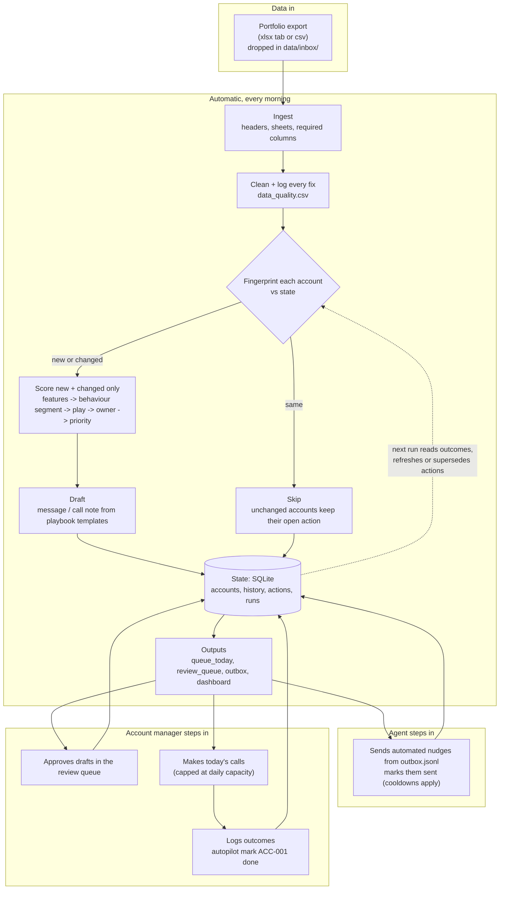

# How it works

The tool is a daily job. A portfolio export comes in, everything that can be
decided by rules is done automatically, and people only see the accounts that
need a person.

## Who does what

| Step | Who | What happens |
|---|---|---|
| Ingest and clean | Automatic | Bad headers, spellings, `£1,234` strings, blanks, duplicates and mismatched totals are fixed and every fix is logged. |
| Change detection | Automatic | Each account's cleaned row is hashed. Unchanged accounts are skipped. A file that was already processed is skipped as a whole, so an old export can't roll accounts back. |
| Segment and decide | Automatic | Behaviour decides the segment; an ordered playbook picks one next action per account; run-rate decides who runs it. |
| Long-tail nudges | Agent | Sends the `auto` messages and records them as sent. Nothing goes to the same account twice inside the cooldown. |
| Mid-value drafts | Agent drafts, AM approves | Personal-sounding emails that are worth a human glance before they go. |
| Key accounts | AM | Calls with a prepared call note: win-backs, migration hand-offs, partial migrations. Capped at the AM's daily capacity; the rest roll to tomorrow. |
| Data problems | AM / ops | e.g. the CRM duplicate on ACC-005: outreach is held until the record is merged. |
| Feedback | AM or agent | `autopilot mark` logs sent / done / snoozed / dismissed. The next run respects it. |

## The rules that keep re-runs safe

1. **One open action per account.** If the account's data changes and the right
   play is the same, the open action is refreshed in place. If the right play
   changes, the old action is marked `superseded` and a new one is opened. If
   the account no longer needs anything, the open action is `resolved`.
2. **Unchanged means untouched.** Scoring is a pure function of the account's
   own row plus config, so an unchanged account would get the same answer
   anyway; it is skipped.
3. **Contact policy.** No account is contacted again inside
   `contact_cooldown_days`, and the same play is never repeated inside
   `same_play_repeat_days`.
4. **Batches are upserts.** A batch can be the whole book or a handful of
   accounts. Accounts not in a batch are left as they are.
5. **Progress is noticed.** When an account's broker reliance falls 10+ points
   between runs it is logged as migration progress, and the reason on its
   action says so (ACC-006 and ACC-008 in the second batch).

## Scale

Everything per-account is vectorised (pandas / numpy). Only new and changed
accounts are re-scored, and the database is indexed on account id.

Measured with `python scripts/bench.py` on a 30,000-account synthetic book
built from the real distributions, with mess injected:

| Step | Rows | New | Updated | Skipped | Scoring | Outputs |
|---|---:|---:|---:|---:|---:|---:|
| Full book, first run | 29,971 | 29,971 | 0 | 0 | ~5 s | ~3.5 s |
| Daily batch | 999 | 899 | 100 | 0 | ~0.4 s | ~2.5 s |
| Same batch again | 999 | 0 | 0 | 999 | ~0.3 s | ~2.5 s |

Zero accounts end with more than one open action. The dashboard embeds the top
1,500 accounts by priority (about 5 MB); the full book is always in
`accounts.csv`.

What would change in production: SQLite becomes Postgres or the warehouse
(the schema is plain SQL), the inbox becomes a scheduled export from the
warehouse, the outbox feeds the CRM or messaging tool, and `mark` becomes a
webhook from that tool.

## Code map

| File | Job |
|---|---|
| `autopilot/ingest.py` | Read xlsx/csv, normalise headers, check required columns |
| `autopilot/clean.py` | Every cleaning rule, each writing to the data-quality log |
| `autopilot/features.py` | Months on book, run-rate, momentum, recency, engagement, health, migration readiness |
| `autopilot/segment.py` | Behavioural segments and label mismatches |
| `autopilot/actions.py` | Ordered playbook, owner routing, priority, coverage recommendation |
| `autopilot/drafts.py` | Fill templates from `config/plays.yaml`; plain-English "why" |
| `autopilot/llm.py` | Optional Claude polish of the top drafts (`--llm N`) |
| `autopilot/state.py` | SQLite store |
| `autopilot/pipeline.py` | One run: change detection, scoring, action reconciliation |
| `autopilot/report.py`, `dashboard.py` | CSV / JSONL / Markdown outputs and the HTML dashboard |
| `config/rules.yaml` | Every threshold |
| `config/plays.yaml` | Every play: owner, channel, goal, message and call-note templates |
